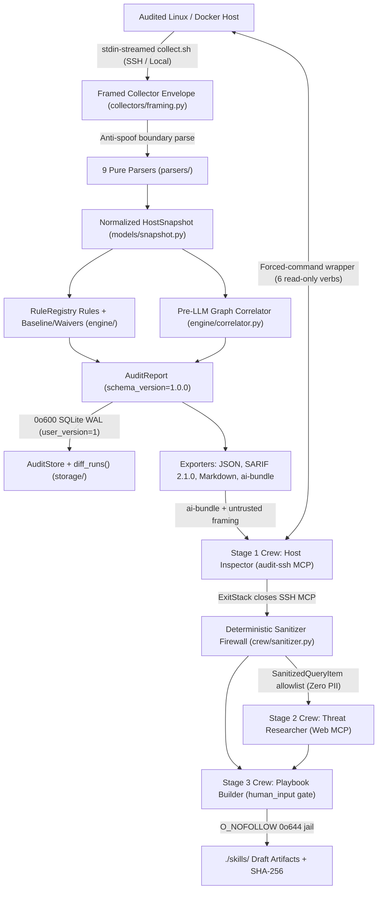

# Architecture

`host-audit-ai` separates **deterministic evidence collection and evaluation** (core package, zero AI dependencies) from **air-gapped multi-stage AI triage** (`[crew]` optional extra).

## End-to-End Data Flow



---

## Module Dependency Matrix

An AST test suite (`tests/test_architecture_boundaries.py`) enforces strict one-way dependencies across the codebase:

| Package / Module | Allowed Internal Dependencies | Forbidden Imports |
| :--- | :--- | :--- |
| `models/` | Python stdlib, `pydantic` | `crew`, `mcp_servers`, `crewai`, `mcp`, `litellm`, `ollama`, `openai` |
| `collectors/` | `models/`, stdlib | `crew`, `mcp_servers`, `crewai`, `mcp`, `litellm`, `ollama`, `openai` |
| `parsers/` | `models/`, stdlib | `crew`, `mcp_servers`, `crewai`, `mcp`, `litellm`, `ollama`, `openai` |
| `engine/` | `models/`, `parsers/`, `pyyaml` | `crew`, `mcp_servers`, `crewai`, `mcp`, `litellm`, `ollama`, `openai` |
| `storage/` | `models/`, `sqlite3` | `crew`, `mcp_servers`, `crewai`, `mcp`, `litellm`, `ollama`, `openai` |
| `exporters/` | `models/`, `engine/` | `crew`, `mcp_servers`, `crewai`, `mcp`, `litellm`, `ollama`, `openai` |
| `cli.py` | Core packages + `typer`, `rich` | Top-level AI/MCP imports (`triage` uses lazy `importlib.util.find_spec`) |
| `mcp_servers/` | `models/`, `collectors/` (`mcp` isolated from `audit_ssh_core.py`) | `crewai` |
| `crew/` | Core packages + optional `crewai`, `crewai_tools`, `mcp` | Core pure-Python modules (`llm.py` config loader, `sanitizer.py`) keep top-level `crewai`/`mcp` imports out |

---

## Schema Versioning & Persistence

- **Report & Triage Schema Version:** `AuditReport.schema_version = "1.0.0"` and `TriageReport.schema_version = "1.0.0"` (`extra="forbid"` enforced on Pydantic v2 contracts).
- **SQLite Schema Version:** `storage/db.py` tracks migrations via `PRAGMA user_version` (`SCHEMA_VERSION = 1`), enabling `PRAGMA foreign_keys = ON` and `PRAGMA journal_mode = WAL` across `hosts`, `runs`, `snapshots`, `findings`, `exposure_chains`, and `triage_runs` tables.
- **Database Permissions:** Newly created directories default to `0o700` and database files to `0o600`. Path resolution follows: explicit `--db` argument `< HOST_AUDIT_DB < $XDG_DATA_HOME/host-audit-ai/audit.db < ~/.local/share/host-audit-ai/audit.db`.

---

## Deterministic Fingerprinting & Drift Diffing

Findings produce reproducible identifiers via `compute_fingerprint(rule_id, normalized_target, key_attribute)`:

```python
payload = f"{rule_id.strip()}|{normalized_target.strip()}|{key_attribute.strip()}"
fingerprint = hashlib.sha256(payload.encode("utf-8")).hexdigest()
```

Volatile runtime attributes (process PIDs, timestamps, ephemeral ports) are excluded from `normalized_target` and `key_attribute` so `storage/diff.py` (`diff_runs()`) accurately tracks finding lifecycles (`NEW`, `PERSISTENT`, `RESOLVED`, `REGRESSED`, `WAIVED`) across sequential runs.

---

## BYOM `LLMConfig` Precedence

`crew/llm.py` (`load_llm_config()`) merges settings in ascending priority order:

1. **Built-in Defaults (`models/triage.py:LLMConfig`):**
   - `model`: `ollama/hf.co/mradermacher/DeepSeek-V4-Pro-Qwen3.5-4B-UNCENSORED-heretic-GGUF:Q4_K_M`
   - `base_url`: `http://127.0.0.1:11434`
   - `temperature`: `0.1`, `stream`: `false`, `max_iter`: `3`, `allow_delegation`: `false`
2. **YAML Configuration File:** resolved via explicit `--llm-config`, `HOST_AUDIT_LLM_CONFIG`, `$XDG_CONFIG_HOME/host-audit-ai/llm.yaml`, or `~/.config/host-audit-ai/llm.yaml`.
3. **Environment Variables:** `HOST_AUDIT_LLM_MODEL`, `HOST_AUDIT_LLM_BASE_URL`, `HOST_AUDIT_LLM_API_KEY`, `HOST_AUDIT_LLM_TEMPERATURE`, `HOST_AUDIT_LLM_STREAM`, `HOST_AUDIT_LLM_MAX_ITER`, `HOST_AUDIT_LLM_ALLOW_DELEGATION`.
4. **CLI Flags:** `--model`, `--base-url`.

Small local GGUF outputs are sanitized by `strip_thinking_and_fences()` (removing `<think>...</think>` blocks and Markdown fences) before strict Pydantic validation in `parse_structured_output()`.
